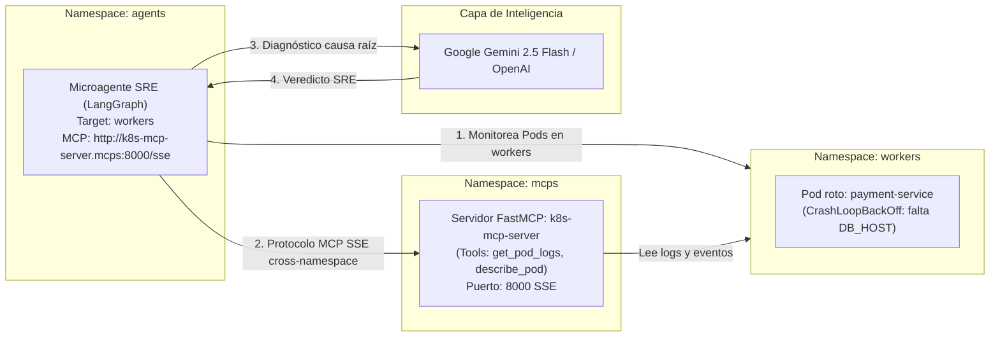

# POC 01: K8s SRE Walking Skeleton (MCP + LangGraph)

Esta Prueba de Concepto (POC) implementa el **Paso 2: Construir el MVP / Walking Skeleton (Días 3-5)** de la arquitectura SRE Agentic, desplegado en **3 namespaces segmentados** de Kubernetes:

* 📦 **`workers`**: Cargas de trabajo y microservicios de la aplicación (incluyendo el pod que falla intencionalmente).
* 🛠️ **`mcps`**: Capa de herramientas y Servidor MCP de Kubernetes (`k8s-mcp-server`).
* 🤖 **`agents`**: Capa Agentic del Microagente SRE en LangGraph (`sre-microagent`).

---

## 🏛️ Arquitectura Multi-Namespace



---

## 📁 Estructura del Proyecto

```text
01-k8s-sre-walking-skeleton/
├── broken-workload/
│   └── broken-pod.yaml           # Despliegue en namespace 'workers' (falla por falta de DB_HOST)
├── k8s-mcp-server/
│   ├── server.py                 # Servidor FastMCP con get_pod_logs y describe_pod
│   ├── Dockerfile                # Imagen Docker del servidor MCP
│   ├── requirements.txt
│   └── k8s/
│       ├── rbac.yaml             # ServiceAccount y ClusterRole en namespace 'mcps'
│       └── deployment.yaml       # Deployment y Service K8s en namespace 'mcps'
├── sre-microagent/
│   ├── agent.py                  # Agente LangGraph que orquesta escaneo, MCP y LLM
│   ├── Dockerfile                # Imagen Docker del microagente SRE
│   ├── requirements.txt
│   ├── .env.example              # Variables de entorno
│   └── k8s/
│       ├── rbac.yaml             # ServiceAccount y ClusterRole en namespace 'agents'
│       ├── secret.yaml           # Secreto K8s en namespace 'agents' con GOOGLE_API_KEY
│       └── deployment.yaml       # Deployment en namespace 'agents'
└── scripts/
    ├── deploy-all.sh             # Despliega los 3 namespaces y todos los componentes
    ├── run-local.sh              # Prueba híbrida local
    └── cleanup.sh                # Limpia los recursos y namespaces
```

---

## 🚀 Despliegue en tu Clúster Local (Kind / Minikube)

### Paso 1: Construir y cargar las imágenes en tu clúster Kind

Desde la raíz de la POC:

```bash
cd agentic-ai/poc/01-k8s-sre-walking-skeleton

# 1. Construir imágenes Docker locales
docker build -t k8s-mcp-server:latest ./k8s-mcp-server
docker build -t sre-microagent:latest ./sre-microagent

# 2. Cargar las imágenes a tu cluster Kind (idp-local-core)
kind load docker-image k8s-mcp-server:latest --name idp-local-core
kind load docker-image sre-microagent:latest --name idp-local-core
```

### Paso 2: Ejecutar el despliegue automático

El script crea los 3 namespaces (`workers`, `mcps`, `agents`), inyecta tu API Key y levanta los servicios:

```bash
./scripts/deploy-all.sh
```

### Paso 3: Verificar los Pods y el Diagnóstico en Vivo

Comprueba el estado de cada namespace:
```bash
kubectl get pods -n workers
kubectl get pods -n mcps
kubectl get pods -n agents
```

Observa la salida en vivo del Agente SRE:
```bash
kubectl logs -f -n agents -l app=sre-microagent
```

Verás la salida esperada:
```text
======================================================================
📢 [SRE AGENT - VERIFICACIÓN]
👉 El Pod payment-service-broken-xxx falló porque le falta la variable DB_HOST.
======================================================================
```

---

## 🧹 Limpieza

Para eliminar todos los recursos y los 3 namespaces:
```bash
./scripts/cleanup.sh
```
